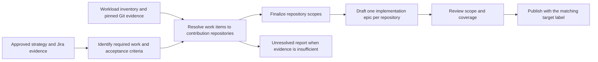

# ADR-0002: Assign one target repository to each implementation epic

Date: 2026-10-22
Updated: 2026-11-02

## Status

Proposed. Plan repository scopes before drafting implementation epics, then publish each reviewed epic with its inventory-defined Jira repository label. The implementation proposal is reviewed separately in AISDLC-547. Production activation requires agreement on the workload and producer/consumer contract, maintained sources and inventory, and verified real-workload acceptance cases.

## Context

AISDLC-90 needs Epic Creator to identify the repository where code generation should run. The AISDLC-4 contract requires each implementation epic to resolve to one canonical repository from an approved inventory, with one code-agent invocation and one pull request.

Repository boundaries must determine the scope and acceptance criteria when epics are created. Adding a repository label to an existing component-oriented epic does not ensure its work fits one repository. Epic Creator therefore needs to resolve the required changes into repository scopes before drafting implementation epics.

The current Fullsend poller accepts a workflow-wide repository and does not read a per-epic target. After determining the repository, Epic Creator must mark the implementation epic with its repository label so the matching Fullsend harness can select it.

Repository mapping needs project-specific evidence. A component catalog or Architecture Context entry can describe repositories and their relationships without establishing which repository is the approved target for a Jira epic. The RHAI mapping document is a candidate source; verify its contents and ownership before treating it as authoritative.

AISDLC-61 provides the workload extension model: a selected workload has a validated definition that configures workload-specific behavior. Epic Creator needs one reusable repository-mapping agent, with evidence sources supplied by the selected project's or domain's workload. RHAI/RHOAI mapping documents and Architecture Context are initial examples; other domains may use ownership catalogs, component mappings, repository metadata, or other maintained documentation. They need not provide the same documents or source types.

## Decision drivers

- Create each implementation epic around exactly one approved contribution repository.
- Preserve all required work and acceptance criteria while grouping by repository.
- Make the assignment traceable to Jira fields and versioned mapping evidence.
- Allow each workload to configure the sources and approved inventory appropriate to its project or domain.
- Keep harness queries consistent with the target assigned by Epic Creator.
- Stop dispatch when evidence is missing, conflicting, stale, or ambiguous.

## Options considered

### Mapping

1. **LLM using repository descriptions:** flexible, but descriptions alone may not distinguish related repositories or establish an authoritative target.
2. **Static Jira-component-to-repository table:** deterministic and reviewable, but requires verified one-to-one mappings and an owner for updates.
3. **Architecture Context as the sole source:** useful for architecture and repository metadata, but the inspected RHODS Operator entry does not define a Jira-to-target rule.
4. **Grounded mapping agent with workload-provided sources:** combines Jira fields, the workload's approved repository inventory, and its configured evidence sources. The same agent interprets different projects' source content and returns a supported target or an unresolved result. It requires source validation, provenance, and abstention behavior.

### Jira and harness routing

1. **Separate Jira project per repository:** simple harness queries where project boundaries already match repository boundaries.
2. **Shared project with a repository label or Component filter:** supports shared projects; a repository label identifies the resolved target, while Component may cover several repositories.
3. **Project scope plus an explicit repository label:** project-specific queries can narrow the results while the repository label remains the dispatch selector. A project such as RHAI can contain epics targeting different repositories.

### When to determine repository boundaries

1. **Assign targets after drafting:** preserves component-oriented epics, which may still require changes in several repositories.
2. **Use drafting instructions alone:** asks for repository grouping without a validated scope contract shared by drafting, review and publication.
3. **Plan repository scopes before drafting:** extracts required changes, resolves them against workload evidence, and finalizes a validated plan before epic text is written.

## Decision

Propose mapping option 4, routing option 3 and creation-time planning option 3.

- Resolve one scalar **target_repository** for each implementation epic: the canonical provider, host, namespace, and repository identity from the approved inventory. Represent that assignment in Jira using exactly one controlled repository label in the `target-repo-<inventory-key>` namespace. This label is the Jira representation; no dedicated target field or description-block fallback is required.
- The approved inventory assigns each repository a stable, unique label and maps it to the full canonical identity. For example, an illustrative inventory entry could map `target-repo-odh-dashboard` to `github.com/opendatahub-io/odh-dashboard`. Labels must distinguish forks, namespaces, and hosts; do not infer the full identity from a bare repository name. Record the selected label alongside the canonical target and mapping evidence.
- Apply the repository label when publishing the resolved, reviewed implementation epic. Updating a resolved assignment replaces any previous label in the controlled `target-repo-` namespace while preserving unrelated Jira labels. An unresolved assignment must not retain a dispatchable repository label.
- Run a shared repository-planning agent before epic drafting. Its process is the same across workloads: read the approved strategy and its Jira evidence, extract concrete required changes and acceptance criteria, examine configured sources, and resolve each implementation work item to one supported canonical repository or an explicit unresolved result. Deterministic finalization groups the resolved work into repository scopes. Keep project-specific URLs, repository names, and mapping rules in workload data.
- Put a configurable list of mapping-source references and the approved-inventory reference in the selected workload's validated definition. Each initial source reference declares its Git location, requested ref and relevant paths; retrieval records the resolved revision and content digests. Retrieve and inject the configured content through the authorized source access mechanism at runtime. A mapping document and an Architecture Context repository are supported design examples, not mandatory slots that every workload must fill. The producer policy below defines the initial Git-backed source contract; additional retrieval formats require a separate shared adapter.
- Select the applicable workload definition for the Jira project or domain before resolution. Project scope selects the mapping context and inventory, not the target repository itself. RHAI and RHOAI can use their configured mapping and architecture evidence; another domain can supply different source types and structures. Sharing a definition or using cross-project component aliases must be explicit in configuration.
- Each workload definition declares the owner and role of every configured source: authoritative contribution-target data or supporting context. Authoritative target data takes precedence over supporting repository metadata; upstream, fork, or manifest-source relationships alone do not establish a contribution target. Conflicting authoritative sources leave the result unresolved. The agent must follow these declared roles for the selected workload's source set.
- Give the planner the approved strategy and verified Jira fields, the approved repository inventory, and the retrieved source content. It returns required work items with one canonical contribution repository and evidence references for each resolved implementation item. Deterministic validation checks the target against the inventory and records workload identity, source URLs and revisions or digests, Jira fields, cited sections, and inventory revision. Inventory membership validates that a repository is allowed; the cited authoritative evidence must also support its selection for this epic.
- Bind the selected target and its evidence to a mapping snapshot containing the workload ID/version and definition digest, Jira inputs, source roles and revisions/content digests, and approved-inventory revision. Carry that binding through decomposition, review, resume, and submission. Before resuming or submitting, verify the bound inputs are unchanged. A change invalidates the prior repository selection and its review; refresh the snapshot, resolve the target, and review the updated plan before submission.
- Each harness queries for its exact repository label, for example `project = RHAI AND labels = "target-repo-odh-dashboard"`. Project scope narrows the query; the label selects the repository. Before dispatch, validate that the epic has exactly one controlled repository label, that it maps to the harness's canonical target in the approved inventory, and that it agrees with the resolved target and current mapping snapshot. A matching JQL query alone does not establish these conditions. Missing, unknown, multiple, or conflicting repository labels block dispatch.
- Return an explicit resolved or unresolved result. A resolved result contains exactly one target and its supporting evidence. An unresolved result contains a reason, candidate approved repositories, and available evidence references; the candidate list may be empty when evidence is unavailable. Preserve unresolved results in the planning report for refinement. If a source is unavailable or stale, evidence conflicts, or the resolver cannot support one target, return unresolved and block publication or dispatch. Do not choose a default or the first candidate.
- Decompose work spanning repositories into repository-specific implementation epics. Multi-repository execution requires a separate change to the AISDLC-4 producer/consumer contract.
- Keep credentials out of workload definitions. Source retrieval must use the configured authorized access mechanism.

### Repository scopes before drafting



The input remains the approved strategy, its accepted attachment or description,
requirements, acceptance criteria and SME input. Repository names are optional.
When supplied, canonicalize and validate them against the selected workload's
contribution inventory. When absent, use the configured evidence. Contradictory
names or unsupported destinations remain unresolved.

Use one implementation epic per canonical repository per input strategy and
effective conditional scenario. Separate strategies may create separate epics in
the same repository.

- Manager and cloudmanager changes, tests, lint and required guidance in the same
  operator repository belong to one operator epic. Dashboard and operator source
  changes belong to separate epics with their interface dependencies preserved.
- Component, team, priority, work-product type and epic size do not split one
  repository's scope into multiple implementation epics. Preserve those details
  on work items and sections within the epic; subsequent story decomposition can
  subdivide the work.
- Code and documentation in the same contribution repository share an epic.
  Guidance published in a different approved repository belongs to that
  repository's epic. An unknown publication destination remains unresolved.
  Mixed scopes retain documentation accuracy checks; a single specialized
  `implementation_type` is retained only for homogeneous scopes.
- A genuine investigation may remain an Investigation epic without an
  implementation target. Unresolved implementation work must not be dropped or
  reclassified as an investigation to make coverage pass.
- Conditional alternatives retain their existing publication behavior. Enforce
  repository uniqueness across every effective scenario, including shared work
  and simultaneously active branches. Never publish mutually exclusive choices
  as simultaneous implementation work.

Repository-local acceptance criteria may reference external APIs, artifacts or an
integration environment, but must not require changes to another repository.
Preserve strategy-wide integration acceptance and traceability in the summary,
with links to the participating repository deliverables.

### Initial workload evidence policy

Add optional `planning.repository_policy` to the workload definition. Workloads
without that policy retain their existing planning behavior. The policy specifies
`mode: one-implementation-epic-per-repository`, an approved inventory selected by
source ID and file path, and configured sources with stable IDs, owners,
authoritative or supporting roles, URLs, explicit refs and selected paths.

Inventory entries record the canonical repository identity, stable inventory key,
unique controlled label and contribution approval reference. Mapping a product,
downstream or fork name to a different contribution repository requires an explicit
inventory alias; a repository relationship alone does not authorize that target.

The initial version assumes evidence files are in accessible Git repositories.
Accept repository URLs or Git-hosted file/directory links; normalize both to Git
URL, ref and paths. Require an explicit ref when the branch/path boundary is
ambiguous. Retrieve selected Markdown, YAML, JSON or text files automatically
through authorized Git access and pin resolved commits and content digests.
Snapshots are runtime caches, rather than manually supplied source inputs.

Optional `repository_policy.guidance: {source_id, path}` selects a Git-hosted
Markdown prompt explaining how to interpret the configured documents. Include
its content and hash in the bound context for planning and review. Guidance
cannot override shared rules, source roles or the approved inventory, and cannot
establish repository ownership by itself. Missing, empty or unreadable configured
guidance blocks planning; changed guidance invalidates the plan and review.

Illustrative configuration; mapping URLs, owners and paths are placeholders:

```yaml
planning:
  repository_policy:
    mode: one-implementation-epic-per-repository
    inventory:
      source_id: repository-mapping
      path: inventory.yaml
    guidance:
      source_id: repository-mapping
      path: interpretation.md
    sources:
      - id: repository-mapping
        owner: mapping-maintainers
        role: authoritative
        url: https://git.example.org/project/repository-mapping.git
        ref: main
        paths: [repository-mapping.md, inventory.yaml, interpretation.md]
      - id: architecture-context
        owner: architecture-maintainers
        role: supporting
        url: https://git.example.org/project/architecture-context.git
        ref: main
        paths: [architecture]
```

RHAI can configure its mapping document and Architecture Context repository as
sources; their locations are not automatically implementation targets. The known
mapping reference is a Google Doc. Activation requires a verified, maintained Git
location under this initial source contract; direct Google Docs retrieval is
outside this version. Verify actual owners, source precedence, release context,
contribution namespaces and publication destinations during workload preparation.

### Bound plan and review contract

Introduce `PLAN_REPOSITORIES` between FETCH and DECOMPOSE. It prepares context,
runs the shared planner and finalizes its proposal before any implementation
epic files are drafted. Produce:

- `artifacts/repository-plans/{ID}-context.json`: the bound strategy, workload,
  inventory, source roles, resolved Git commits, file digests and optional guidance;
- `artifacts/repository-plans/{ID}-proposal.json`: required work and proposed
  repository assignments from the planner;
- `artifacts/repository-plans/{ID}.json`: validated repository scopes and explicit
  unresolved items, consumed by drafting, review, revision and submission.

Each work item records source requirement and acceptance references, a concrete
change, implementation or investigation kind, delivery type, priority, ownership
and dependencies. Split requirements spanning repositories into concrete work
items that retain their original source references. Each resolved implementation
item has one inventory target with supporting evidence. Unresolved items record
a reason, candidate targets and available evidence.

Deterministic finalization groups implementation items by canonical target,
preserving their acceptance criteria and provenance. Dependencies inside a
repository become internal sequencing; cross-repository dependencies connect the
resulting scopes. A dependency cycle blocks publication rather than deleting
edges or silently changing boundaries.

Each implementation epic carries `repository_scope`, `work_item_ids`,
`target_repository` and `mapping_snapshot_digest`. The target includes
`inventory_key`, `provider`, `host`, `namespace` and `repository` and must match
its inventory entry. Preserve all canonical Jira components in `components`,
with the first ordered, deduplicated value retained as the compatibility
`component` field.

Review binds both the repository plan and the complete decomposition content.
Deterministic validation checks identities, assignment, source coverage,
uniqueness and provenance. Independent semantic review also checks that the scope
and acceptance text fit the selected repository and preserve the strategy's
intent; correct IDs or inventory membership alone cannot establish that.

Before resume or submission, refresh configured source refs and compare resolved
commits and content manifests with the bound snapshot. Changed strategy,
workload, inventory, sources or guidance require replanning and fresh review.
An explicit commit remains pinned, subject to the workload's freshness policy.
Unavailable, missing, expired or conflicting required evidence blocks the source.

### Publication and activation boundary

Unresolved required implementation work blocks publication of all generated epics
for that strategy while preserving a useful planning report. Other strategies in
a batch may continue. Owner verification is development and workload preparation;
resolved runs remain automatic without a new manual approval step per run.

Preflight all epics before the first Jira write. Include exactly the target's
inventory label in the initial create request, together with unrelated workflow
labels, and publish the canonical target and pinned evidence with the artifact.
Recovery validates actual Jira labels and content against the reviewed plan and
retains the existing ambiguous-create protection. A previously created epic with
a missing or conflicting target must fail recovery rather than silently dispatch.

Both explicit-workload and default entry points enforce the policy when the
selected workload enables it. Historical artifacts remain readable but must be
regenerated and reviewed before repository-mode submission. Automatic migration,
relabeling of existing Jira issues and deployment of the Fullsend consumer are
outside this producer implementation. Production workloads remain disabled for
this policy until maintained sources, contribution inventory and real-case
expectations are verified.

## Consequences

- Repository assignment has an explicit producer/consumer contract and can be audited against the inputs used to make it.
- Projects and domains configure their evidence sources and inventory while sharing the same mapping-agent behavior. Workloads do not need RHAI-shaped documents or an Architecture Context repository. Supporting additional retrieval formats may require shared source adapters; project-specific mapping policy remains in workload data.
- Repository boundaries are established before drafting and retained through review and publication; component and team details remain inside each repository scope.
- The pipeline gains a planning stage and requires maintained Git evidence. Source changes invalidate bound plans and reviews.
- Missing or ambiguous mapping evidence blocks the affected strategy and requires correction or source verification; normal resolved runs remain automatic.
- The Fullsend consumer must change to read and validate the per-epic repository label against its configured repository and the mapping snapshot; its current workflow-wide target is insufficient.
- Production activation depends on agreement about the controlled label convention and inventory entries, harness JQL, workload policy, named inventory and source owners, source access, and the resolved/unresolved evidence contract.

## Validation

Before accepting this proposal, evaluate the resolver against representative RHAI cases and at least one real non-RHAI project's configured sources, with expected targets verified by the relevant project owners. Include correct single-target mappings, one-to-many and many-to-many component relationships, cross-repository decomposition, ambiguous or conflicting evidence, unavailable sources, and changes to bound inputs.

The non-RHAI evaluation must exercise a different source structure or source type. Verify that workload selection supplies the intended inventory and source set, that evidence from another workload cannot silently influence the result, and that unconfigured RHAI-specific source types are not required. This must demonstrate reuse of the mapping agent rather than a separate domain-specific resolver.

Check target correctness separately from inventory membership: selecting the wrong approved repository fails the evaluation. Cases without sufficient evidence must return unresolved with the expected reason, candidates, and available evidence. The agreed acceptance cases must produce the verified targets or expected unresolved outcomes before the design is accepted. These evaluations are required work; this ADR does not claim they have passed.

Also verify repository-label publication and dispatch: one resolved target produces its inventory-defined label; reassignment replaces the old repository label and preserves unrelated labels; unresolved or invalidated assignments cannot dispatch using an old label. Missing, unknown, multiple, or conflicting repository labels must be rejected even when the epic matches the harness query.

## References

- [AISDLC-547 producer implementation and plan, stacked on PR #40](https://github.com/amastbau/epic-creator/pull/2)
- [AISDLC-546 — Verify mapping sources and evaluation cases](https://redhat.atlassian.net/browse/AISDLC-546)
- [AISDLC-548 — Consume the per-epic repository contract](https://redhat.atlassian.net/browse/AISDLC-548)
- [AISDLC-90 — Tag implementation epics with target repositories](https://redhat.atlassian.net/browse/AISDLC-90)
- [AISDLC-61 — Make Epic Decomposer support pluggable planning workloads](https://redhat.atlassian.net/browse/AISDLC-61)
- [AISDLC-4 — Deploy Fullsend code generation for Red Hat AI engineering](https://redhat.atlassian.net/browse/AISDLC-4)
- [RHAISTRAT-2376 — AWS Neuron Support for Red Hat AI](https://redhat.atlassian.net/browse/RHAISTRAT-2376)
- [Architecture Context repository](https://github.com/opendatahub-io/architecture-context/)
- [RHODS Operator architecture entry](https://github.com/opendatahub-io/architecture-context/blob/main/architecture/rhoai-2.10/rhods-operator.md)
- [RHAI component-to-repository mapping notes](https://docs.google.com/document/d/1Hv34Ci58_BIhWmWJXKE34w2ZlQrQWMeg_fjvMsv4Erk/edit?tab=t.0#heading=h.wdwmerquvvbx) — candidate source; verify contents and ownership
- [Fullsend poller at the inspected revision](https://github.com/fullsend-ai/fullsend/blob/15136ebc5b31720b80a8a45220c58b0dfda9d6ec/internal/cli/poll.go)
- [Fullsend Jira integration guide at the inspected revision](https://github.com/fullsend-ai/fullsend/blob/15136ebc5b31720b80a8a45220c58b0dfda9d6ec/docs/guides/user/jira-integration.md)
- [Jira JQL labels field](https://support.atlassian.com/jira-software-cloud/docs/jql-fields/#Labels)
